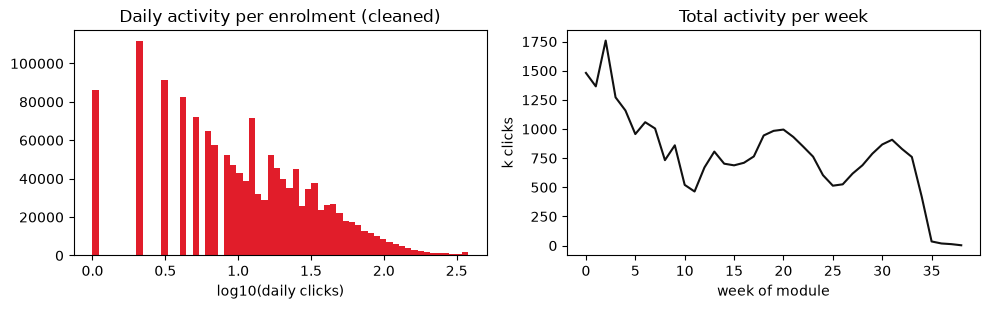
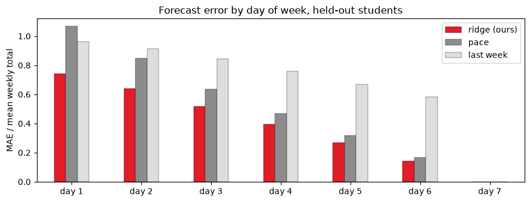
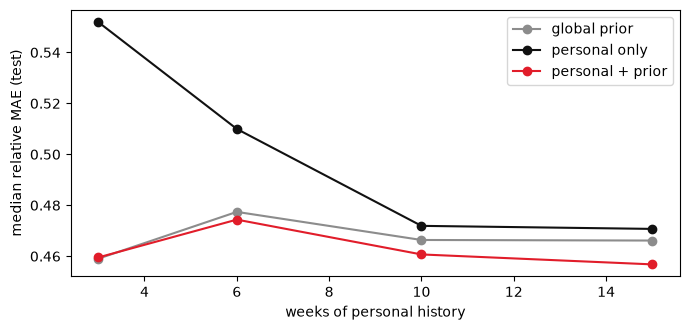
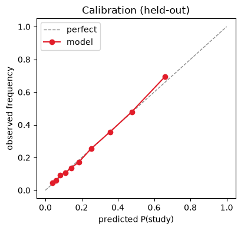
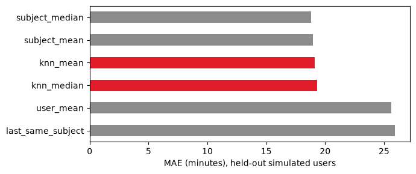
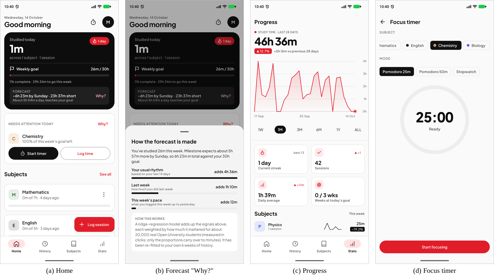

**Abstract** — শিক্ষার্থীরা প্রতিদিন কোন subject কতক্ষণ পড়ছে, সাপ্তাহিক লক্ষ্যের (weekly goal) কতটা পূরণ হলো, আর কোন subject পিছিয়ে পড়ছে, তা বোঝার জন্য আমরা *Milestone* নামের একটি সম্পূর্ণ **offline** Android অ্যাপ তৈরি করেছি। অ্যাপটি Figma design থেকে **Kotlin**, **Jetpack Compose**, **MVVM** architecture এবং লোকাল **Room database** দিয়ে বানানো। এতে তিনটি **on-device machine learning** ফিচার আছে: (১) **Ridge Regression** দিয়ে সপ্তাহ শেষের মোট পড়ার সময়ের **forecast**, (২) **Logistic Regression**-এর calibrated probability থেকে "আজ কোন subject অবহেলিত হওয়ার ঝুঁকিতে আছে" সেই **suggestion**, এবং (৩) session length suggestion, যেখানে evaluation-এ জেতা **per-subject median** ব্যবহার করা হয়েছে। প্রতিটি মডেলের "Why?" ব্যাখ্যা অ্যাপের ভেতরেই দেখা যায়। মডেল ট্রেনিংয়ে বাস্তব ডেটাসেট **OULAD** (Open University Learning Analytics Dataset) ব্যবহার করা হয়েছে এবং একটি আলাদা notebook-এ পুরো **preprocessing** নথিভুক্ত করা হয়েছে। Student-ভিত্তিক held-out test set-এ forecast মডেলের relative MAE ৩৮.৬%, যেখানে "বর্তমান গতি ধরে রাখা" baseline-এর ৫০.০%। Recommender-এর **AUC ০.৭৯৫** এবং **Expected Calibration Error ০.০০৭**। কোথায় মডেল baseline-কে হারাতে পারেনি, তাও আমরা সৎভাবে উল্লেখ করেছি এবং সেই অনুযায়ী product decision নিয়েছি। শেষে তিনটি স্বাধীন review agent (UI/accessibility, logic/ML, UX) দিয়ে অ্যাপ যাচাই করে পাওয়া সমস্যাগুলো ঠিক করা হয়েছে।

**Index Terms** — Android, Jetpack Compose, MVVM, Room, on-device machine learning, ridge regression, logistic regression, calibration, explainable AI, learning analytics, OULAD, accessibility (WCAG).

---

## I. ভূমিকা (Introduction)

### A. সমস্যা (Problem)

অনেক শিক্ষার্থী পরীক্ষার আগে বুঝতে পারে যে একটি-দুটি subject অনেক পিছিয়ে আছে। সাধারণ timer বা to-do অ্যাপ শুধু সময় রেকর্ড করে, কিন্তু তিনটি প্রশ্নের উত্তর দেয় না:

1. এই গতিতে চললে সপ্তাহ শেষে আমি কোথায় পৌঁছাব?
2. আজ কোন subject-টা আমার অভ্যাসের কারণে বাদ পড়ে যেতে পারে?
3. একটা session সাধারণত আমার কতক্ষণের হয়?

### B. লক্ষ্য (Objectives)

- Figma design (৯টি screen) হুবহু অনুসরণ করে একটি পূর্ণাঙ্গ Android অ্যাপ বানানো।
- অ্যাপ সম্পূর্ণ **offline** হবে। কোনো server নেই, `INTERNET` permission-ও নেই।
- শিক্ষার্থী নিজের মতো subject, color tag আর weekly goal যোগ, পরিবর্তন ও মুছতে পারবে।
- যেখানে সত্যিই কাজে লাগে, শুধু সেখানে **Machine Learning** ব্যবহার হবে। প্রতিটি মডেল আলাদা **Jupyter Notebook (.ipynb)**-এ নথিভুক্ত থাকবে।
- বাস্তব ডেটাসেট ব্যবহার করা হবে এবং ব্যবহারের আগে তার **preprocessing** করা হবে।
- লজিক যেন **ব্যাখ্যাযোগ্য (explainable)** হয়, আর **Logcat**-এ পুরো প্রক্রিয়া দেখা যায়।
- পড়ার সময় মাপতে একটি **Focus Timer** থাকবে।
- Color combination-এর **accessibility (WCAG contrast)** নিয়ে বিশেষ সতর্কতা থাকবে।
- কাজ হবে professional মানের, যেখানে novelty, accuracy আর honesty বজায় থাকবে।

### C. অবদান (Contributions)

1. একটি সম্পূর্ণ offline study tracker, যেখানে Room-এ timer state সংরক্ষণ করা হয়। ফলে অ্যাপ বন্ধ বা kill হলেও timer হারায় না।
2. **Unit-invariant feature design**: click-ভিত্তিক বাস্তব ডেটা (OULAD) থেকে শেখা weight কেন মিনিট-ভিত্তিক অ্যাপে ব্যবহার করা যায়, তার গাণিতিক যুক্তি।
3. Recommender-কে "আপনি কী পড়বেন তা অনুমান করা"র বদলে **calibrated probability দিয়ে "অবহেলার ঝুঁকি"** খোঁজার কাজে ব্যবহার করা, অর্থাৎ $need = goal\_left \times (1-p)$।
4. প্রতিটি মডেল একই data-তে একাধিক baseline-এর সাথে তুলনা করা, এবং যেখানে সরল baseline জিতেছে সেখানে সেটাই ship করা (duration model)।
5. অ্যাপের ভেতরে "Why?" explanation sheet এবং `Milestone.ML` Logcat tag দিয়ে মডেলের প্রতিটি সিদ্ধান্ত দৃশ্যমান রাখা।

---

## II. সিস্টেম ওভারভিউ ও আর্কিটেকচার (System Overview)

### A. প্রযুক্তি (Technology Stack)

**TABLE I: ব্যবহৃত প্রযুক্তি ও version**

| অংশ | প্রযুক্তি | Version |
|---|---|---|
| ভাষা | Kotlin (AGP 9-এর built-in Kotlin) | 2.2.10 |
| UI | Jetpack Compose, Material 3 | Compose BOM 2026.02.01 |
| Architecture | MVVM (ViewModel + StateFlow) | Lifecycle 2.9.4 |
| Database | Room (SQLite) + KSP | Room 2.8.4, KSP 2.3.10 |
| Navigation | Navigation Compose | 2.9.7 |
| Build | Android Gradle Plugin / Gradle | 9.4.1 / 9.6.0 |
| SDK | minSdk / targetSdk / compileSdk | 26 / 37 / 37 |
| ML (training) | Python, NumPy, pandas, scikit-learn, Jupyter | Python 3.14 |
| Font | Plus Jakarta Sans (variable font, bundled) | OFL |

**minSdk 26 কেন:** `java.time` (তারিখ ও সপ্তাহের হিসাব) এবং variable font-এর `FontVariation` সরাসরি ব্যবহার করার জন্য।

### B. স্তরভিত্তিক আর্কিটেকচার (Layered Architecture)

```
UI (Compose Screens) ──observe──> ViewModel (StateFlow)
                                     │
                     ┌───────────────┼────────────────┐
                     ▼               ▼                ▼
            StudyRepository     StudyInsights      FocusTimer
              (data/repo)      (ml/ – 3 models)    (timer/)
                     │               │                │
                     ▼               ▼                ▼
            Room DAOs ──> SQLite   assets/ml/*.json  AlarmManager,
            (data/db)              (notebook export) Notification
```

**Fig. 1:** Milestone-এর data flow। UI কখনো সরাসরি database-এ যায় না। সব পথ ViewModel আর Repository হয়ে যায়।

### C. প্যাকেজ বিভাজন (Code Separation) এবং কেন

| Package / ফাইল | দায়িত্ব | আলাদা রাখার কারণ |
|---|---|---|
| `data/db` | Room `Entity`, `DAO`, `MilestoneDatabase` | Database schema এক জায়গায় থাকে। schema JSON export হয় `app/schemas`-এ |
| `data/repo/StudyRepository` | Single source of truth, সব DB লেখা এবং DB Logcat | UI ও ML database-এর খুঁটিনাটি জানে না, তাই test আর পরিবর্তন সহজ |
| `data/repo/StudyMath` | Streak, subject summary (non-ML) | Pure function, তাই সহজে unit test করা যায় |
| `ml/` | `WeeklyForecaster`, `SubjectRecommender`, `DurationSuggester`, `StudyHistory`, `ModelConfig` | প্রায় pure Kotlin, Android UI নেই। তাই JVM unit test-এ চালানো যায় |
| `assets/ml/*.json` | Notebook থেকে export করা weight ও hyper-parameter | **Notebook ↔ App সেতু:** মডেল আবার train করলে Kotlin code না বদলেই নতুন weight অ্যাপে চলে আসে |
| `timer/FocusTimer` | Timer logic, notification, alarm, `TimerDoneReceiver` | UI ছাড়াও (broadcast receiver থেকে) চলতে পারে |
| `ui/…` | প্রতিটি screen + তার ViewModel | MVVM অনুযায়ী screen আর state আলাদা |
| `ui/components` | Figma component (Card, Chip, Field, Button, NavBar) + `ExplainSheets` | একবার বানিয়ে সব screen-এ পুনর্ব্যবহার করা হয় |
| `ui/theme` | Figma token (Color, Type) | Design token এক জায়গায় থাকে, contrast যাচাই সহজ |
| `ui/MessageBus` | App-wide snackbar channel | Screen বদলালেও "Undo" বার্তা হারায় না |
| `util/AppLog` | Logcat tag | Demo-তে area অনুযায়ী filter করা যায় |
| `ml/build_notebooks.py` | চারটি notebook **generate** করে | Notebook-এর code text আকারে version control-এ থাকে এবং পুনরুৎপাদনযোগ্য |
| `ml/milestone_sim.py` | Simulated study log generator | শুধু duration notebook-এ লাগে, তাই আলাদা module |
| `tools/svg2vd.py` | Figma SVG থেকে Android VectorDrawable | Icon pipeline পুনরুৎপাদনযোগ্য |

**বিশেষ অংশ ১: `build_notebooks.py`।** Notebook সরাসরি হাতে না লিখে একটি Python script দিয়ে generate করা হয়েছে। এর তিনটি সুবিধা আছে:

- প্রতিটি cell-এর code সাধারণ text হিসেবে review করা যায়।
- একটি বাগ ঠিক করলে সব notebook একসাথে আপডেট হয়।
- `python build_notebooks.py 01 02` দিয়ে শুধু নির্দিষ্ট notebook আবার বানানো যায়।

তারপর `jupyter nbconvert --execute` চালিয়ে notebook-গুলোর output (সংখ্যা ও গ্রাফ) ফাইলের ভেতরেই সংরক্ষণ করা হয়।

**বিশেষ অংশ ২: `StudyHistory`।** সব মডেল একই day-indexed history ব্যবহার করে। `lastStudied()` ফাংশনটি training loop-এর ভেতরে বহুবার ডাকা হয়। তাই এতে প্রথমে linear search ছিল, পরে review-এর পর **binary search** করা হয়েছে (Section VIII)।

---

## III. ডেটাসেট (Dataset Selection)

### A. কেন বাস্তব ডেটাসেট

প্রথম সংস্করণে মডেলগুলো একটি simulator-এর ডেটায় train করা হয়েছিল। পরে বাস্তব ডেটা ব্যবহারের সিদ্ধান্ত হয়, কারণ simulator-এ আমরা যা ধরে নিই, মডেল সেটাই শেখে। বাস্তব আচরণ শেখার জন্য বাস্তব ডেটা দরকার।

### B. বিবেচিত ডেটাসেট

| ডেটাসেট | কী আছে | সিদ্ধান্ত |
|---|---|---|
| **OULAD** [1] | ৩২,৫৯৩ enrollment, প্রতিদিন প্রতি student-এর VLE activity (clicks), ৭টি module, ২০১৩–১৪ | **গ্রহণ করা হয়েছে।** CC-BY 4.0 license, UCI repository থেকে সরাসরি download করা যায় |
| ATUS (American Time Use Survey) [12] | Homework/study episode-এর শুরুর সময় ও দৈর্ঘ্য | **ব্যবহার করা যায়নি।** BLS server scripted download block করে |
| UCI Student Performance | শুধু চূড়ান্ত নম্বর, দৈনিক log নেই | অপ্রাসঙ্গিক |

**OULAD কেন সবচেয়ে উপযুক্ত:** এটি student → course → দিন অনুযায়ী study activity-র সবচেয়ে বড় খোলা-লাইসেন্সের log। Milestone-এর data-র গঠনও হুবহু এক: student → subject → দিন অনুযায়ী মিনিট।

### C. শুরুতেই স্বীকার করা সীমাবদ্ধতা

1. OULAD মাপে **click**, মিনিট নয়।
2. OULAD-এর দিন গোনা হয় module শুরুর দিন থেকে, ক্যালেন্ডারের দিন নয়। তাই "সপ্তাহ" মানে শুরু থেকে ৭ দিনের block।
3. OULAD-এ শিক্ষার্থীর নিজের weekly goal নেই।

এগুলো কীভাবে সামলানো হয়েছে, তা Section IV ও V-তে বলা আছে।

---

## IV. ডেটা প্রিপ্রসেসিং (Preprocessing) — `00_dataset_preprocessing.ipynb`

### A. Data-quality audit

**TABLE II: কাঁচা ডেটার মান যাচাই**

| পরীক্ষা | সংখ্যা |
|---|---|
| `studentVle` মোট row | ১০,৬৫৫,২৮০ |
| হুবহু duplicate row | ৭৮৭,১৭০ |
| Module শুরুর আগের row (`date < 0`) | ৬৮৮,৯৮৮ |
| Registration date নেই | ৪৫ |
| Unregistration নেই (অর্থাৎ withdraw করেনি) | ২২,৫২১ |
| `vle.csv`-তে নেই এমন site | ০ |

**Duplicate নিয়ে সিদ্ধান্ত:** OULAD প্রতিটি recording event-এর জন্য একটি row রাখে। তাই একই click সংখ্যার দুটি row আসলে দুটি আলাদা interaction batch, copy error নয়। ডেটাসেটের লেখকরা activity মানে `sum_click`-এর **যোগফল** ধরেছেন, তাই আমরা row ফেলে না দিয়ে যোগ করেছি। স্বচ্ছতার জন্য মেপে দেখা হয়েছে: duplicate ফেলে দিলে মোট click-এর মাত্র **৩.২%** কমত।

### B. Cleaning rule এবং প্রতিটির কারণ

1. **`homepage` activity বাদ।** এটি শুধু course-এর landing page-এ ঢোকা, পড়া নয়। মোট ৬,৯৪৯,০৬৪ click বাদ পড়েছে।
2. **শুধু teaching period রাখা:** `0 ≤ date < module_presentation_length`।
3. **Withdrawal মানা:** `date_unregistration`-এর দিন বা তার পরের activity বাদ।

   Rule ১–৩-এর পরে ১০,৬৫৫,২৮০ row-এর মধ্যে **৮,৩০৪,৩৮৪** row রয়ে গেছে।
4. **কম signal-এর enrollment বাদ:** ১৪ দিনের কম active, অথবা ২৮তম দিনের আগে withdraw করেছে। এতে **২৭,৮৮৯-এর মধ্যে ২১,৪৭১** enrollment রাখা হয়েছে (১৯,৭৮৫ জন student)। কারণ: এত কম ডেটায় সাপ্তাহিক প্যাটার্ন থাকে না, আর অ্যাপও এই পরিমাণ history ছাড়া মডেল চালু করে না।
5. **Winsorization:** দৈনিক click-কে 99.9th percentile-এ (**৩৭৭ click**) আটকে দেওয়া হয়েছে, যাতে ১,৪২৪টি অস্বাভাবিক দিন (যেমন bulk download) squared-error loss-কে নিয়ন্ত্রণ করতে না পারে।
6. **Multi-module learner টেবিল:** একই semester-এ ২–৩টি module নেওয়া student আসলে Milestone-এর "একাধিক subject"-এর সবচেয়ে কাছের বাস্তব উদাহরণ। এমন **৪১২ জন** learner পাওয়া গেছে (৪৯,৩৭০ learner-module-day)।



**Fig. 2:** Preprocessing-এর পরে ডেটার বণ্টন।

### C. Output

`data/processed/`-এ তিনটি tidy টেবিল (Parquet) লেখা হয়: `enrolments`, `daily_enrolment`, `daily_multimodule`। কাঁচা ও processed ডেটা `.gitignore`-এ রাখা হয়েছে, কারণ notebook চালালে আবার download হয়।

---

## V. মডেল ডিজাইন ও ট্রেনিং (Model Design & Training)

সব মডেলের জন্য সাধারণ নিয়ম:

- **Split by student:** student id-এর MD5 hash দিয়ে deterministic ২০% **held-out test**। একজন student কখনো train আর test দুই জায়গাতেই থাকে না, তাই memorization ধরা পড়ে।
- Hyper-parameter শুধু **validation** (training student-দের একটি অংশ) দিয়ে বাছাই করা হয়। Test set শুধু একবার, চূড়ান্ত রিপোর্টের জন্য ব্যবহার হয়।
- প্রতিটি মডেলকে অন্তত একটি সরল **baseline**-এর সাথে তুলনা করা হয়।

### A. Weekly Forecast — Ridge Regression [2] (`01_weekly_goal_forecast.ipynb`)

**কাজ:** সপ্তাহের d-তম দিনের শেষে, বাকি দিনগুলোতে আর কত পড়া হবে তার অনুমান। চূড়ান্ত forecast হলো $so\_far + \max(0, \hat{y})$, তাই এটি কখনো ইতিমধ্যে log করা সময়ের নিচে নামে না।

**Feature** ($left = 1 - \frac{d+1}{7}$):

| Feature | সংজ্ঞা |
|---|---|
| `f_hist` | left × (সপ্তাহের আগের ১৪ দিনের গড় দৈনিক activity) × ৭ |
| `f_last` | left × গত সপ্তাহের মোট |
| `f_pace` | left × so_far / ((d+1)/7) — বর্তমান গতি |

**কেন Ridge Regression:**

- মাত্র ৩টি feature-এর linear মডেল, তাই প্রতিটি অংশের অবদান অ্যাপে হুবহু দেখানো যায় (explainability)।
- Closed-form সমাধান $w=(X^TX+\lambda I)^{-1}X^Ty$, যা ফোনে কয়েক microsecond-এ চলে।
- Feature-গুলো একে অপরের সাথে correlated (গত সপ্তাহ বনাম ১৪ দিনের গড়), তাই L2 regularization দরকার।

**Click থেকে মিনিটে যাওয়ার গাণিতিক যুক্তি (unit invariance):** তিনটি feature-ই activity-র একক অনুযায়ী linear, এবং মডেলে কোনো intercept নেই। সব activity-কে একটি ধ্রুবক $c$ দিয়ে গুণ করলে (click থেকে মিনিট) প্রতিটি feature আর target দুটোই $c$ গুণ হয়:

$$\arg\min_w \|cXw - cy\|^2 = \arg\min_w \|Xw-y\|^2$$

অর্থাৎ weight একই থাকে। এই কারণেই weekly goal-কে feature বানানো হয়নি, কারণ OULAD-এ goal নেই।

**Training:** ৪৮,১০,৩৭৯টি row (প্রতিটি enrollment-সপ্তাহ-দিন)। Validation-এ বিভিন্ন λ-তে MAE প্রায় সমান ছিল (১৫.৬২ থেকে ১৫.৫৭), তাই λ = 10⁸ নির্বাচিত হয়েছে। প্রাপ্ত weight: `f_hist` 0.4242, `f_last` 0.1051, `f_pace` 0.1737।

**Personalisation:** ফোনে নিজের ডেটা দিয়ে আবার fit করা হয়, global weight $w_0$-এর দিকে টান রেখে:

$$w = (X^TX + \lambda I)^{-1}(X^Ty + \lambda w_0), \quad \lambda = \lambda_{rel}\cdot \frac{\sum x^2}{n}$$

$\lambda_{rel}=100$ এবং চালু হওয়ার সীমা (**৩ সপ্তাহ**) দুটোই validation student-দের উপর বাছাই করা হয়েছে।

### B. "Needs attention" Recommender — Logistic Regression [3] (`02_next_subject_recommender.ipynb`)

**Label:** learner দিন t-তে subject s পড়েছে কি না। সব feature শুধু t-এর **আগের** দিনগুলো থেকে হিসাব করা হয় (no leakage):

| Feature | সংজ্ঞা |
|---|---|
| `log_days_since` | log(1 + শেষবার পড়ার পর কত দিন), সর্বোচ্চ ৩০ |
| `goal_left` | এই সপ্তাহের লক্ষ্যের কত অংশ বাকি (0–1) |
| `weekday_affinity` | শেষ ৮টি একই বারের মধ্যে কত ভাগে পড়েছে |
| `share_14d` | গত ১৪ দিনের মোট সময়ের মধ্যে এই subject-এর ভাগ |
| `yesterday` | গতকাল পড়েছে কি না (0/1) |

**Goal proxy (সততার নোট):** OULAD-এ goal না থাকায় training-এ লক্ষ্য ধরা হয়েছে learner-এর আগের ৪ সপ্তাহের median activity। এর নিচের সীমা হলো ওই module-এ তার আগের সব non-zero সপ্তাহের median। এখানে **শুধু অতীতের সপ্তাহ** ব্যবহার করা হয় (look-ahead নেই)। অ্যাপে শিক্ষার্থীর আসল goal ব্যবহার হয়। সব feature unit-free, তাই click থেকে মিনিটে সমস্যা হয় না।

**কেন Logistic Regression:**

- Probability দেয়, যা calibrated হতে পারে।
- Coefficient থেকে প্রতিটি কারণের প্রভাব সরাসরি ব্যাখ্যা করা যায়।
- ফোনে SGD দিয়ে personalise করা সহজ।

**On-device personalisation:** ব্যবহারকারীর শেষ সর্বোচ্চ ১২০ দিনের ডেটায় SGD [14] চালানো হয় (lr 0.005, epoch 1), L2 দিয়ে global weight-এর দিকে টান রেখে (l2 0.01):

$$w \leftarrow w - \eta\big[(\sigma(w^Tx)-y)\,x + \lambda_2 (w - w_0)\big]$$

**Decision rule এবং কেন এটি:** evaluation-এ দেখা গেছে, মডেলটি "কে কোন subject পড়বে তা অনুমান" করার ক্ষেত্রে "গতকাল যা পড়েছে" baseline-কে হারায় না (Section VI-B)। আর গতকালের subject আবার পড়তে বলা কোনো উপকারী পরামর্শও নয়। তাই আমরা মডেলের calibrated probability $p$ ব্যবহার করে খুঁজি কোন subject অভ্যাসের কারণে আজ **বাদ পড়ার ঝুঁকিতে** আছে:

$$need(s) = goal\_left(s) \times (1 - p(s))$$

আজ ইতিমধ্যে পড়া subject-এর জন্য $p = 1$ ধরা হয়, ফলে তার need = 0।

### C. Session Length — k-NN বনাম Median (`03_session_duration_knn.ipynb`)

**ডেটা নিয়ে সততা:** সময়সহ পড়ার session-এর কোনো খোলা ডেটাসেট download করা যায়নি (ATUS blocked), আর OULAD-এ শুধু দৈনিক click আছে। তাই এই notebook-এ একটি স্বচ্ছ simulator (`milestone_sim.py`, ৩০০ জন user, ১,৪০,০৩৬ session) দিয়ে পদ্ধতিগুলো **তুলনা** করা হয়েছে। মডেলের নিজের কোনো trained weight নেই। ফোনে এটি শুধু ব্যবহারকারীর নিজের ডেটা থেকে হিসাব করে।

**k-NN distance** [4]:

$$d = w_s[\text{ভিন্ন subject}] + w_h\frac{|\Delta hour|}{12} + w_d[\text{ভিন্ন বার}] + w_a\frac{age}{30}$$

Grid search-এর (৬৪টি combination × mean/median) পরে held-out user-দের ফলাফলে **per-subject median জিতেছে** (Table V)। তাই অ্যাপ সেটাই ship করে।

**Code-এর বিশেষ অংশ:** আলাদা code path না লিখে k-NN config-কেই এমনভাবে সেট করা হয়েছে যে এটি হুবহু median-এর মতো আচরণ করে: $w_s = 10^6$, বাকি weight 0, k = 1000, aggregate = median। Kotlin-এর weighted median-কে NumPy-র `np.median`-এর সাথে মেলাতে একটি unit test লেখা হয়েছে। এই test-ই একটি বাস্তব বাগ ধরেছে: জোড় সংখ্যক session থাকলে মাঝের দুটির গড় না নিয়ে উপরেরটি নিচ্ছিল (Section VIII)।

---

## VI. মূল্যায়ন ও ফলাফল (Evaluation & Results)

### A. মেট্রিক (Metrics)

- **MAE** (Mean Absolute Error): গড়ে কত ভুল।
- **Relative MAE** = MAE / গড় সাপ্তাহিক মোট। এটি unit-free, তাই click আর মিনিটে একই অর্থ দেয়।
- **AUC** [6]: subject পড়বে আর পড়বে না, এই দুটিকে মডেল কত ভালো আলাদা করে (০.৫ = random)।
- **Log-loss:** probability কত ভালো।
- **ECE** (Expected Calibration Error) [5]: মডেল যখন "৩০%" বলে, তখন সত্যিই প্রায় ৩০% ঘটে কি না।
- **Top-1 hit rate:** সবচেয়ে উপরের suggestion-টি সত্যিই পড়া হয়েছিল কি না।

### B. ফলাফল

**TABLE III: Weekly forecast (held-out student, relative MAE; কম হলে ভালো)**

| দিন | Ridge (আমাদের) | Pace baseline | Last-week baseline |
|---|---|---|---|
| ১ | **০.৭৪০** | ১.০৬৭ | ০.৯৬৪ |
| ২ | **০.৬৪১** | ০.৮৪৮ | ০.৯১৩ |
| ৩ | **০.৫১৭** | ০.৬৩৬ | ০.৮৪৩ |
| ৪ | **০.৩৯৪** | ০.৪৬৭ | ০.৭৬০ |
| ৫ | **০.২৭০** | ০.৩১৭ | ০.৬৬৯ |
| ৬ | **০.১৪৩** | ০.১৬৭ | ০.৫৮৫ |
| সামগ্রিক | **৩৮.৬%** | ৫০.০% | ৬৭.৬% |



**Fig. 3:** Ridge মডেল প্রতিদিন দুটি baseline-কেই হারায়। সামগ্রিকভাবে pace baseline-এর তুলনায় প্রায় ২৩% কম error।

**Personalisation (test, median relative MAE):** ৩ সপ্তাহে global prior ০.৪৫৯০ বনাম personal ০.৪৫৯৫ (প্রায় সমান)। ৬ সপ্তাহে ০.৪৭৭৪ → ০.৪৭৪৪, ১০ সপ্তাহে ০.৪৬৬৪ → ০.৪৬০৭, ১৫ সপ্তাহে ০.৪৬৬২ → ০.৪৫৬৮। **সৎ মূল্যায়ন:** লাভ ছোট, কিন্তু history যত বাড়ে তত ধারাবাহিক। শুধু নিজের ডেটায় fit করলে (prior ছাড়া) ফল সবসময় খারাপ ছিল।



**Fig. 4:** Personal history যত বাড়ে, "personal + prior" মডেল global prior-এর তুলনায় তত সামান্য ভালো হয়।

**TABLE IV: Recommender (৪১২ জন learner-এর মধ্যে ৮১ জন held-out)**

| মেট্রিক | মান |
|---|---|
| AUC | **০.৭৯৫** |
| Log-loss | ০.৪৪০৭ (constant-rate baseline ০.৫৫১৪) |
| ECE | **০.০০৭** |
| Top-1: Logistic Regression | ০.৭৯৭ |
| Top-1: "গতকাল যা পড়েছে" | **০.৮০৬** |
| Top-1: "সবচেয়ে বেশি goal বাকি" | ০.৫৩৫ |
| Top-1: random | ০.৬৬৩ |
| Personalisation log-loss | ০.৪২৩০ → ০.৪২১১ (+০.৫%) |



**Fig. 5:** Calibration curve প্রায় কর্ণরেখার (perfect line) উপর। তাই probability-গুলো বিশ্বাসযোগ্য, আর এর উপরেই decision rule দাঁড়িয়ে আছে।

**সৎ পাঠ:** Top-1 অনুমানে মডেল recency baseline-কে হারায়নি। এই কারণেই মডেলটি ranker হিসেবে ব্যবহার করা হয়নি, তার calibrated probability-কে "অবহেলার ঝুঁকি" মাপতে ব্যবহার করা হয়েছে। Decision rule-টি offline-এ score করা সম্ভব নয়, কারণ কোন subject পড়া "উচিত ছিল" তার ground truth নেই। এটি একটি স্বচ্ছ product decision, যা একটি calibrated estimate-এর উপর দাঁড়িয়ে।

**TABLE V: Session length (simulated held-out user, MAE মিনিট)**

| পদ্ধতি | MAE |
|---|---|
| **Per-subject median (shipped)** | **১৮.৮১** |
| Per-subject mean | ১৮.৯৭ |
| k-NN (mean) | ১৯.১৩ |
| k-NN (median) | ১৯.৩৩ |
| User mean | ২৫.৬৪ |
| Last same-subject | ২৫.৯১ |



**Fig. 6:** সরল median-ই সবচেয়ে ভালো, তাই জটিল k-NN-এর বদলে সেটাই ship করা হয়েছে।

---

## VII. অ্যাপ কীভাবে কাজ করে ও কীভাবে বানানো হয়েছে (Implementation)

### A. ধাপে ধাপে উন্নয়ন (Chronological Development)

1. **Design পড়া:** Figma MCP দিয়ে ৯টি screen-এর metadata, design context, variable (color ও typography token) আর screenshot নেওয়া হয়। Screen-গুলো হলো Home, Log session, Validation, History, Session detail, Delete dialog, Subject manager, Add-subject sheet এবং Progress।
2. **Icon ও font:** ৪৬টি SVG download করা হয়। একই icon-এর একাধিক রূপ বাদ দিয়ে `tools/svg2vd.py` দিয়ে ৩২টি icon Android VectorDrawable-এ রূপান্তর করা হয় (stroke color কালো করা হয়, যাতে Compose-এ tint করা যায়)। Plus Jakarta Sans variable font bundle করা হয়, যাতে offline-এ কাজ করে।
3. **Toolchain বাছাই:** মেশিনে আগে থেকে cache-এ থাকা AGP 9.4.1 + Gradle 9.6 ব্যবহার করা হয়। Room-এর জন্য KSP 2.3.10 যোগ করা হয়।
4. **Data layer:** Room entity, DAO, database এবং `StudyRepository` তৈরি করা হয়, সাথে DB Logcat।
5. **ML পরিকল্পনা:** প্রথমে simulator ব্যবহার করা হয়। পরে বাস্তব ডেটা (OULAD) আনা হয়, preprocessing notebook-এ বাধ্যতামূলক পরিষ্কার করা হয়, তারপর তিনটি modeling notebook চালানো হয়। Notebook-গুলো `assets/ml/*.json`-এ weight export করে।
6. **সৎ মূল্যায়নের পর পুনর্নকশা:** recommender-কে "ranker" থেকে "অবহেলার ঝুঁকি"-তে নেওয়া হয়। Duration-এ k-NN-এর বদলে median নেওয়া হয়।
7. **Kotlin ML engine:** `WeeklyForecaster` (Gaussian elimination দিয়ে ridge solve), `SubjectRecommender` (logistic + SGD), `DurationSuggester` (weighted median)।
8. **UI:** Theme token, shared component, প্রতিটি screen + ViewModel, Navigation, `MessageBus` snackbar।
9. **Focus Timer** (নতুন ফিচার): Room-এ state রাখা হয়, সাথে notification chronometer ও AlarmManager।
10. **Explainability ও Logcat:** "Why?" sheet এবং `AppLog` tag।
11. **Build ও test:** unit test, emulator-এ চালানো, screenshot নেওয়া।
12. **Multi-agent review এবং fix** (Section VIII), তারপর আবার যাচাই।

### B. Room Database — বিস্তারিত

**Room কী:** Android Jetpack-এর একটি **persistence library**, যা SQLite-এর উপরে একটি abstraction layer [8]। আমরা Kotlin class-এ `@Entity` (টেবিল), `@Dao` (query) আর `@Database` annotation লিখি। Build-এর সময় **KSP** (Kotlin Symbol Processing) এগুলো থেকে আসল SQL code generate করে।

**কেন Room (কাঁচা SQLite বা file নয়):**

- **Compile-time SQL verification:** ভুল column নাম থাকলে অ্যাপ চলার আগেই build fail করে।
- **`Flow` সাপোর্ট:** টেবিল বদলালে UI নিজে থেকেই আপডেট হয়।
- Coroutine (`suspend`) দিয়ে main thread-এর বাইরে IO হয়।
- Foreign key, index, unique constraint দিয়ে **data integrity** নিশ্চিত হয়।
- Schema JSON export থাকায় ভবিষ্যৎ migration-এর ভিত্তি তৈরি থাকে।
- Offline অ্যাপের জন্য relational ডেটা (subject ↔ session) রাখার সবচেয়ে উপযুক্ত উপায়।

**TABLE VI: Database schema (version 1)**

| টেবিল | Column | Constraint / Index | কেন |
|---|---|---|---|
| `subjects` | id, name, colorIndex, weeklyGoalMinutes, createdAt | `name` **UNIQUE**, `COLLATE NOCASE` | "physics" আর "Physics" duplicate হিসেবে ধরা পড়ে, DB স্তরেই |
| `sessions` | id, subjectId, durationMinutes, dateEpochDay, startHour, loggedAt, notes, source | `subjectId` → subjects.id **FOREIGN KEY ON DELETE CASCADE**; index: subjectId, dateEpochDay | Subject মুছলে তার session-ও মুছে যায়। তারিখ ও subject দিয়ে দ্রুত query হয় |
| `active_timer` | id (=1), subjectId, mode, targetMinutes, runningSince, accumulatedMs, startedAt | একটিমাত্র row | Timer হলো **state**, ticking thread নয়। process মারা গেলেও সঠিক থাকে |

**তারিখ সংরক্ষণ:** `dateEpochDay` (`LocalDate.toEpochDay()`)। সময়-অঞ্চল (time zone) বা DST-এর কারণে দিন সরে যায় না, আর সপ্তাহ ও স্ট্রিকের হিসাব সাধারণ integer অঙ্ক হয়ে যায়।

**কীভাবে connect করা হয়েছে (wiring):**

```kotlin
// 1) Database তৈরি — MilestoneDatabase.kt
Room.databaseBuilder(context, MilestoneDatabase::class.java, "milestone.db").build()

// 2) Application-এ একবার (manual DI) — MilestoneApp.kt
val db = MilestoneDatabase.create(this)
repository = StudyRepository(db)

// 3) Repository Flow দেয়
val sessions: Flow<List<SessionEntity>> = db.sessionDao().observeAll()

// 4) ViewModel Flow-গুলো combine করে StateFlow বানায়
combine(repo.subjects, repo.sessions, ...) { ... }
    .flowOn(Dispatchers.Default).stateIn(viewModelScope, ...)

// 5) Compose screen observe করে
val state by vm.state.collectAsStateWithLifecycle()
```

ফলে প্রবাহটি হলো: ব্যবহারকারী session save করেন → DAO `insert` → Room টেবিল বদল টের পায় → `Flow` নতুন list emit করে → ViewModel নতুন state বানায় (ML-ও আবার চলে) → Compose screen redraw হয়। কোথাও হাতে "refresh" করতে হয় না।

**Dependency Injection:** অ্যাপ ছোট বলে Hilt বা Dagger ছাড়াই `MilestoneApp` (Application class)-এ একবার database, repository, ML engine আর timer তৈরি করা হয়েছে। ViewModel factory (`appViewModel {}`) সেগুলো পায়।

**Backup:** `backup_rules.xml` ও `data_extraction_rules.xml`-এ `milestone.db`, `-wal` ও `-shm` ফাইল রাখা আছে, কারণ Room WAL mode ব্যবহার করে। নইলে restore করলে সাম্প্রতিক session হারিয়ে যেতে পারত।

**Migration নীতি:** Schema এখন version 1, আর JSON `app/schemas`-এ export হয়। ভবিষ্যতে কোনো টেবিল বদলানোর আগে AutoMigration ও migration test যোগ করতে হবে। Destructive fallback ইচ্ছাকৃতভাবে রাখা হয়নি, কারণ এতে ব্যবহারকারীর ডেটা মুছে যেতে পারে।

### C. MVVM ও State

প্রতিটি screen-এর একটি ViewModel আছে, যা একটি immutable `UiState` data class-এর `StateFlow` দেয়। Heavy কাজ, যেমন ML ও পরিসংখ্যান, `Dispatchers.Default`-এ চলে। `todayFlow()` মধ্যরাতে নতুন তারিখ emit করে, ফলে অ্যাপ খোলা থাকলেও "আজ" বদলে যায়।

### D. Focus Timer

- **ডিজাইন:** timer-এর সময় গোনা হয় wall-clock দিয়ে: $elapsed = accumulated + (now - runningSince)$। তাই rotation, background বা process death-এর পরেও সময় সঠিক থাকে, foreground service ছাড়াই।
- **Notification:** চলাকালীন system chronometer দেখায় (Pomodoro-তে countdown)।
- **Pomodoro শেষ হলে:** `AlarmManager` (exact permission না থাকলে inexact fallback) একটি `TimerDoneReceiver` চালায়। এটি session **নিজে থেকেই save করে** এবং notification দেয়।
- **Finish & save:** session শুরুর দিনের তারিখে save হয়, তারপর notes লেখার জন্য edit screen খোলে।
- **Discard:** নিশ্চিত হওয়ার জন্য dialog দেখায়।
- **Subject মোছা:** কোনো subject-এর timer চলাকালীন সেই subject মোছা যায় না।

### E. Explainability ও Logcat

- **"Why?" sheet:**
  - Forecast: প্রতিটি feature কত মিনিট যোগ করছে।
  - Recommender: কোন কারণ সম্ভাবনা বাড়ায় বা কমায়, আর সব subject-এর need।
  - Duration: কোন কোন পুরনো session থেকে median নেওয়া হয়েছে।
- **Logcat:** `adb logcat -s Milestone.UI Milestone.DB Milestone.ML Milestone.Timer`। উদাহরণ:

```
Milestone.ML: Recommender: Biology(p=0.14, left=1.00, need=0.86),
  Chemistry(p=0.14, ...), English(p=0.64, left=0.92, need=0.33) -> 'Biology'
Milestone.DB: INSERT session id=87 subject=5 1min day=20740 source=timer
```

### F. Design ও Color Accessibility

Figma token-গুলো `ui/theme/Color.kt`-এ রাখা হয়েছে। প্রতিটি রঙের জোড়া WCAG 2.1 [7] অনুযায়ী মাপা হয়েছে:

- **Text:** কমপক্ষে ৪.৫:১।
- **Large text / icon / progress bar:** কমপক্ষে ৩:১।

যেখানে Figma-র রঙ এই মান পূরণ করেনি, সেখানে কাছাকাছি গাঢ় রঙ নেওয়া হয়েছে:

| উপাদান | Figma | পরিবর্তিত | কারণ |
|---|---|---|---|
| ছোট caption | #8C8C8C (৩.২২:১) | #6E6E6E (৪.৮৯:১) | Text contrast |
| Amber subject | #FF8A00 (track-এ ২.০২:১) | #C76A00 (৩.২৭:১) | Progress bar |
| Grey subject | #9E9E9E (২.২৯:১) | #757575 (৩.৯৪:১) | Progress bar |
| Today card-এর goal track | 22% white (২.১১:১) | 12% white (৩.০১:১) | লাল fill দৃশ্যমান রাখা |
| "Red" subject | #E11D2A | Green #2E7D32 | লাল শুধু brand ও error-এর জন্য, যাতে বিভ্রান্তি না হয় |

প্রতিটি subject color-এর তিনটি রূপ আছে:

- `accent`: bar ও dot-এর জন্য।
- `text`: হালকা tint-এর উপর অক্ষরের জন্য। প্রতিটি কমপক্ষে ৫.১:১।
- `onAccent`: গাঢ় accent-এর উপর icon বা অক্ষরের জন্য।

এ ছাড়াও touch target কমপক্ষে ৪৮dp, আর TalkBack-এর জন্য heading ও selected state যোগ করা হয়েছে।



**Fig. 7:** চলমান অ্যাপের চারটি screen (Pixel 8 Pro emulator, test data): (a) Home: Today card, ML forecast এবং "Needs attention" suggestion; (b) forecast-এর "Why?" sheet, যেখানে প্রতিটি feature-এর অবদান দেখা যায়; (c) Progress: chart, range tab, stat tile ও subject watchlist; (d) Focus timer।

---

## VIII. যাচাই, Review এবং পরিবর্তনসমূহ (Verification & Changes)

### A. Unit test

`app/src/test/.../ModelsTest.kt`-এ ১৩টি test আছে, যেমন:

- Linear solver সঠিক উত্তর দেয়।
- Singular matrix-এ crash না করে null ফেরত দেয়।
- Forecast কখনো log করা সময়ের নিচে যায় না।
- ১৪ দিনের আগে forecast দেখায় না।
- নিয়মিত পড়ুয়াকে সকালে "পিছিয়ে আছ" বলে না।
- আজ পড়া subject suggest করে না।
- Median ঠিক `np.median`-এর সমান হয়।
- Streak-এর নিয়ম ঠিক কাজ করে।

সবগুলো pass করেছে।

### B. Test থেকে ধরা পড়া বাগ

Duration-এর weighted median জোড় সংখ্যক session-এ ৪০ ও ৫০-এর মাঝে ৪৫ না দিয়ে ৫০ দিচ্ছিল, অর্থাৎ notebook-এর baseline-এর সাথে মিলছিল না। Kotlin-এ ঠিক করা হয়েছে এবং test যোগ করা হয়েছে।

### C. তিনটি স্বাধীন review agent এবং তাদের ফলাফল

অ্যাপ শেষ হওয়ার পরে তিনটি আলাদা বিশেষজ্ঞ AI agent দিয়ে review করা হয়েছে। প্রত্যেকে শুধু রিপোর্ট দিয়েছে, তারপর আমরা fix করেছি।

**TABLE VII: প্রধান ত্রুটি ও সমাধান**

| ধরন | সমস্যা | সমাধান |
|---|---|---|
| Crash | Timer চলাকালীন subject মুছে Finish চাপলে app crash করত এবং সময় হারিয়ে যেত | Subject মোছা block করা হয়েছে; আগে save, তারপর timer clear |
| ML লজিক | Forecast আজকের দিনকে শেষ হওয়া দিন ধরত, ফলে প্রতিদিন সকালে "পিছিয়ে আছ" বলত | Feature এখন "গতকালের শেষ" অনুযায়ী হিসাব হয়; ১৪ দিনের আগে forecast লুকানো থাকে |
| ML পদ্ধতি | Notebook 02-এর goal proxy ভবিষ্যতের সপ্তাহ দেখত (leakage) | শুধু অতীতের সপ্তাহ; আবার চালানো হয়েছে (AUC ০.৭৯৪ থেকে ০.৭৯৫, প্রায় অপরিবর্তিত) |
| ML পদ্ধতি | Notebook 01-এ personalisation test student-দের উপর tune হয়েছিল | এখন validation-এ tune করা হয়, test-এ একবার রিপোর্ট |
| ML ব্যাখ্যা | আজ পড়া subject-কেও "৪% সম্ভাবনা" বলত | আজ পড়া হলে p = 1 |
| Performance | Recommender-এর SGD main thread-এ চলত | `Dispatchers.Default`-এ সরানো হয়েছে, cache যোগ হয়েছে, ১২০ দিনের সীমা, binary search |
| UX | Undo-র পরে ফেরত আসা session খোলা যেত না | Swipe state reset করা হয় |
| UX | এক swipe-এ দুবার DELETE হতো (Logcat-এ ধরা পড়েছে) | একবারের guard যোগ |
| UX | Undo snackbar কখনো সরত না | `Long` duration + dismiss বাটন |
| UX | Pomodoro শেষে নিজে save হতো না; মধ্যরাত পার হলে ভুল দিনে save হতো | Auto-save; session শুরুর দিনে save |
| UX | অনুমিত duration আগে থেকেই ভরা থাকত (অনুমান ডেটায় পরিণত হতো) | এখন শুধু "suggested" chip দেখায় |
| UX | Subject-এ ট্যাপ করলে log screen খুলত | এখন subject-এর নিজস্ব history page খোলে |
| Accessibility | Contrast, ৪৮dp touch target, TalkBack selected state | Section VII-F অনুযায়ী ঠিক করা হয়েছে |
| Data | Double-tap-এ duplicate save হতো; duplicate নাম শুধু code-এ আটকানো হতো | Saving guard যোগ; DB-তে UNIQUE NOCASE |
| Stats | নতুন user-এর গড় ৩৬৫ দিনে ভাগ হতো; শেষ সাপ্তাহিক বিন্দু এক দিনের হতো | প্রথম log থেকে হিসাব; শেষ দিক থেকে সাপ্তাহিক bucket |

---

## IX. সীমাবদ্ধতা ও ভবিষ্যৎ কাজ (Limitations & Future Work)

1. **Click বনাম মিনিট:** unit-invariance শুধু এককের সমস্যা মেটায়। click আর মিনিট যে কিছুটা আলাদা আচরণ মাপে, সেই সমস্যা পুরোপুরি মেটায় না।
2. **জনসংখ্যা:** OULAD-এর student-রা ২০১৩–১৪ সালের দূরশিক্ষণের (distance learning) শিক্ষার্থী। স্কুল বা বিশ্ববিদ্যালয়ের শিক্ষার্থীদের আচরণ আলাদা হতে পারে। এজন্যই personalisation রাখা হয়েছে।
3. **Recommender:** মাত্র ৪১২ জন multi-module learner, প্রত্যেকের ২–৩টি subject। Decision rule offline-এ যাচাই করা যায় না।
4. **Duration:** তুলনা করা হয়েছে simulated ডেটায়।
5. **এখনো যা নেই:**
   - প্রতি সপ্তাহের goal আলাদা করে সংরক্ষণ। Stats এখন অতীতের সপ্তাহকেও আজকের goal দিয়ে মাপে, এবং সেভাবেই label করা আছে।
   - Reminder, CSV export, subject archive, dark theme, manual session-এর শুরুর সময়।
   - Reboot-এর পরে Pomodoro alarm আবার schedule করা।
   - Room migration test।
6. **ভবিষ্যৎ:** ব্যবহারকারীর সম্মতিতে, offline-এই নিজের ডেটা দিয়ে মডেলের মান মাপা (on-device evaluation), এবং পড়ার সময়সহ কোনো খোলা ডেটাসেট পাওয়া গেলে duration মডেল আবার পরীক্ষা করা।

---

## X. উপসংহার (Conclusion)

Milestone দেখায় যে একটি সম্পূর্ণ offline অ্যাপেও বাস্তব ডেটায় train করা, পরীক্ষিত এবং ব্যাখ্যাযোগ্য machine learning সম্ভব। আমাদের মূল শিক্ষা হলো, ভালো ML মানে সবসময় জটিল মডেল নয়:

- **Forecast:** Ridge মডেলটি baseline-এর চেয়ে স্পষ্টভাবে ভালো, তাই রাখা হয়েছে।
- **Recommender:** ranker হিসেবে baseline-কে হারায়নি, তাই তার calibrated probability ভিন্ন ও বেশি উপকারী কাজে লাগানো হয়েছে।
- **Duration:** সরল median জিতেছে, তাই সেটাই ship করা হয়েছে।

প্রতিটি সিদ্ধান্ত notebook-এর সংখ্যা দিয়ে সমর্থিত, আর অ্যাপের "Why?" sheet এবং Logcat-এ ব্যবহারকারী নিজেই তা দেখতে পারেন।

---

## স্বীকৃতি (Acknowledgment)

এই প্রকল্পটি একটি AI coding assistant (Claude Code)-এর সহায়তায় আমার নির্দেশনা অনুযায়ী তৈরি হয়েছে। চূড়ান্ত review-ও তিনটি স্বাধীন AI review agent দিয়ে করানো হয়েছে। সব সিদ্ধান্ত, ডেটা-উৎস ও সীমাবদ্ধতা এই নথিতে খোলাখুলি লেখা আছে। OULAD ডেটাসেটের জন্য Open University (Kuzilek et al.) এবং Plus Jakarta Sans font-এর জন্য Tokotype-এর প্রতি কৃতজ্ঞতা।

---

## তথ্যসূত্র (References)

[1] J. Kuzilek, M. Hlosta, and Z. Zdrahal, "Open University Learning Analytics dataset," *Scientific Data*, vol. 4, Art. no. 170171, 2017, doi: 10.1038/sdata.2017.171.

[2] A. E. Hoerl and R. W. Kennard, "Ridge regression: Biased estimation for nonorthogonal problems," *Technometrics*, vol. 12, no. 1, pp. 55–67, 1970.

[3] D. R. Cox, "The regression analysis of binary sequences," *J. Roy. Stat. Soc. B*, vol. 20, no. 2, pp. 215–242, 1958.

[4] T. Cover and P. Hart, "Nearest neighbor pattern classification," *IEEE Trans. Inf. Theory*, vol. 13, no. 1, pp. 21–27, 1967.

[5] C. Guo, G. Pleiss, Y. Sun, and K. Q. Weinberger, "On calibration of modern neural networks," in *Proc. ICML*, 2017, pp. 1321–1330.

[6] T. Fawcett, "An introduction to ROC analysis," *Pattern Recognit. Lett.*, vol. 27, no. 8, pp. 861–874, 2006.

[7] W3C, "Web Content Accessibility Guidelines (WCAG) 2.1," W3C Recommendation, 2018.

[8] Android Developers, "Save data in a local database using Room," developer.android.com/training/data-storage/room.

[9] Android Developers, "Guide to app architecture," developer.android.com/topic/architecture.

[10] F. Cirillo, *The Pomodoro Technique*. New York, NY, USA: Currency, 2018.

[11] F. Pedregosa *et al.*, "Scikit-learn: Machine learning in Python," *J. Mach. Learn. Res.*, vol. 12, pp. 2825–2830, 2011.

[12] U.S. Bureau of Labor Statistics, "American Time Use Survey," bls.gov/tus.

[13] Free Software Foundation, "GNU Affero General Public License, Version 3," 2007.

[14] H. Robbins and S. Monro, "A stochastic approximation method," *Ann. Math. Statist.*, vol. 22, no. 3, pp. 400–407, 1951.

---

## লাইসেন্স (License)

প্রকল্পটি **GNU AGPL-3.0-only** [13] license-এর অধীনে প্রকাশিত। সাথে AGPL-এর Section 7 অনুযায়ী অতিরিক্ত শর্ত আছে (`NOTICE` ফাইল):

- কেউ অ্যাপটি বা তার পরিবর্তিত রূপ প্রকাশ করলে পুরো source code একই license-এ প্রকাশ করতে হবে।
- "Based on Milestone by Ratul" credit রাখতে হবে।
- নিজের মৌলিক কাজ বলে দাবি করা যাবে না।
- "Milestone" নাম বা logo অনুমতি ছাড়া ব্যবহার করা যাবে না।

## Appendix: পুনরুৎপাদন (Reproducibility)

```bash
# ML: notebook বানানো ও চালানো (data নিজে থেকে download হয়)
cd ml && python build_notebooks.py
jupyter nbconvert --to notebook --execute --inplace 0*.ipynb

# App build ও test
./gradlew assembleDebug testDebugUnitTest

# Logcat
adb logcat -s Milestone.UI Milestone.DB Milestone.ML Milestone.Timer

# এই নথির PDF
bash docs/build_pdf.sh
```
